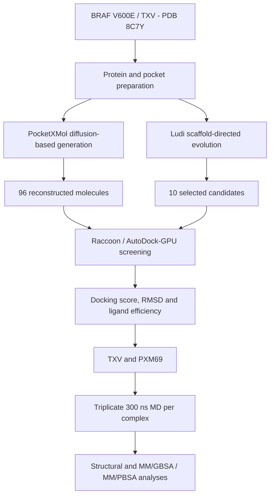

# Design of BRAF Inhibitors Using a Diffusion-Based Generative Model and De Novo Evolution

Supporting data and computational workflows for the manuscript:

**Scaffold-Preserving Design of BRAF Inhibitors Using a Diffusion-Based Generative Model and De Novo Evolution: A Case Study**

Sergey Shityakov, Carola Foerster, Huiqun Wu, and Ekaterina V. Skorb

## Overview

This study compares two structure-based molecular design strategies targeting BRAF V600E: pocket-conditioned molecular generation using PocketXMol, a diffusion-based generative model, and scaffold-directed fragment evolution using the BIOVIA Discovery Studio Ludi algorithm. The crystallographic inhibitor TXV (PDB: [8C7Y](https://www.rcsb.org/structure/8C7Y)) serves as the reference compound.

The workflow integrates molecular generation, docking, ligand-efficiency assessment, structural alignment, molecular dynamics (MD), and endpoint binding free energy calculations.

## Repository structure

| Directory | Purpose |
| --- | --- |
| [Analysis](Analysis/) | Computational results and comparative analyses |
| [BLAST](BLAST/) | Protein sequence analysis |
| [Binding_site](Binding_site/) | Binding-pocket definition and preparation |
| [Docking](Docking/) | Molecular docking inputs and results |
| [Iterative_RMSD](Iterative_RMSD/) | Iterative structural alignment and scaffold conservation analysis |
| [Ludi](Ludi/) | Scaffold-directed de novo fragment evolution |
| [MD/GBSA_PBSA](MD/GBSA_PBSA/) | MD-based MM/GBSA and MM/PBSA binding energy analysis |
| [PXM](PXM/) | PocketXMol molecular generation |
| [Raccoon](Raccoon/) | Virtual screening and docking-based ranking |
| [Swiss-model](Swiss-model/) | Template-based protein structure modeling |

## Computational workflow



## Computational settings

| Stage | Settings reported in the manuscript |
| --- | --- |
| Structural template | PDB 8C7Y; X-ray resolution 1.65 Å |
| PocketXMol | 100 requested molecules; 100 diffusion steps; pocket radius 15 Å; sampling seed 2024; complete seed 8057; CPU sampling |
| Pocket center | (−8.257, 85.181, 19.05) Å |
| Ludi | De Novo Evolution workflow v1.40; PLP1 scoring; two generations; up to three surviving scaffold families; wrapper seed 0 |
| Docking | AutoDock-GPU; Lamarckian genetic algorithm; up to 30 runs per ligand; population 150; maximum 2,500,000 evaluations and 27,000 generations |
| Docking grid | 60 × 60 × 60 points; spacing 0.375 Å; center (−6.610, 86.630, 19.590) Å |
| MD | AMBER 22; FF99SB; GAFF; AM1-BCC; TIP3P water; 310 K; 2 fs timestep |
| Production sampling | Three independent 300 ns replicas per complex; 1.8 μs total |
| Statistics | GraphPad Prism 10.1.2; two-sided unpaired Student's t-test; Cohen's d |

## Principal findings

PocketXMol successfully reconstructed 96 of 100 requested molecules. Ludi generated larger candidates with favorable docking scores but less favorable ligand efficiencies and higher docking RMSD values. PXM69 was selected for MD analysis alongside TXV.

| Metric | TXV | PXM69 |
| --- | ---: | ---: |
| Heavy atoms | 36 | 30 |
| Rotatable bonds | 5 | 5 |
| Docking score (kcal/mol) | −12.59 | −12.08 |
| Docking-derived ligand efficiency (kcal/mol/heavy atom) | −0.35 | −0.40 |
| Reported largest-cluster RMSD (Å) | 1.29 | 1.28 |

PXM69 retained the predicted Asp421 interaction while reducing heavy-atom count by approximately 16.7%. However, endpoint binding energy estimates favored TXV.

| Method | ΔΔG (kcal/mol) |
| --- | ---: |
| MM/GBSA | +16.53 |
| MM/PBSA | +29.56 |

Here, ΔΔG = ΔG(PXM69) − ΔG(TXV). Positive values indicate less favorable predicted binding energetics for PXM69 relative to TXV.

## Access and reproduction

Clone the repository:

```bash
git clone https://github.com/virtualscreenlab/PXM_Ludi.git
cd PXM_Ludi
```

Consult the relevant directories and manuscript methods for inputs, parameters and analysis outputs. Reproduction requires access to the corresponding software, including PocketXMol, BIOVIA Discovery Studio (Ludi), Raccoon, AutoDock-GPU, AMBER 22 and the statistical analysis software. Proprietary software and model dependencies may require separate installation or licensing. The Ludi wrapper seed does not guarantee identical internal fragment poses.

## Limitations

This is a computational case study based on a single structural template and specific generator configurations. Ludi candidates were not advanced to MD, preventing a direct MD-based comparison between generation strategies. The findings do not establish experimental binding affinity, kinase inhibition, selectivity or biological activity. PXM69 is a computational starting point for further optimization and experimental validation.

## Citation

If you use this repository, please cite the associated manuscript:

> Shityakov, S., Foerster, C., Wu, H., and Skorb, E. V. Scaffold-Preserving Design of BRAF Inhibitors Using a Diffusion-Based Generative Model and De Novo Evolution: A Case Study. Manuscript.

Repository: https://github.com/virtualscreenlab/PXM_Ludi

## Contact

**Corresponding author:** Sergey Shityakov — [shityakoff@hotmail.com](mailto:shityakoff@hotmail.com)

**GitHub:** [virtualscreenlab](https://github.com/virtualscreenlab)

## License

Consult the repository's applicable license and third-party software terms before reuse or redistribution. No new license is declared by this README.
